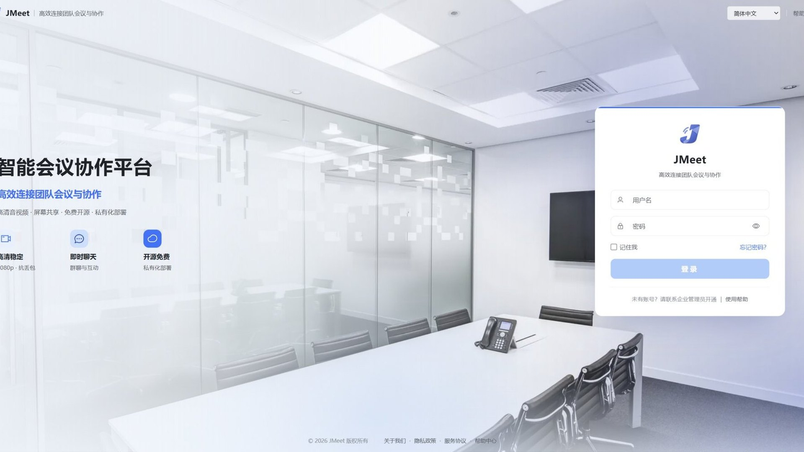
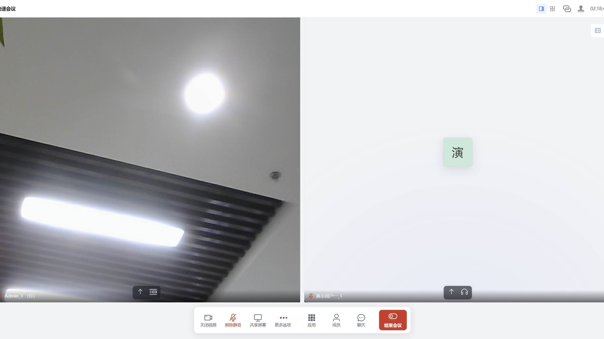
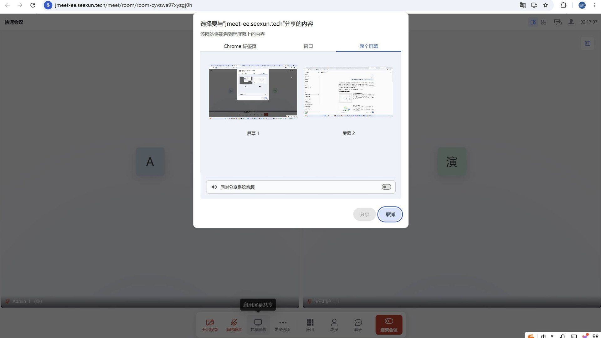
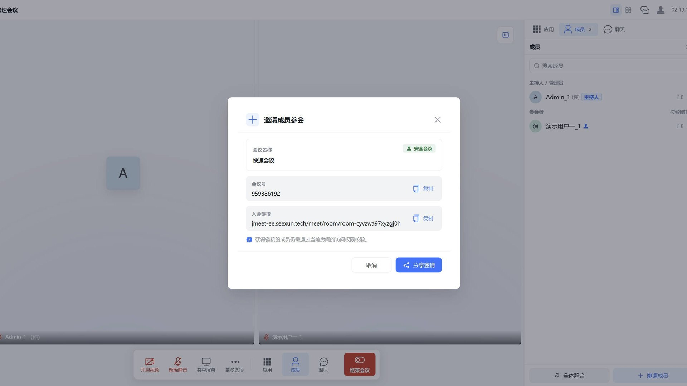

<div align="center">


# JMeet

**开源 · 私有化部署 · 企业级视频会议**

[](LICENSE)
[](#-快速开始)
[](#-社区与支持)

</div>

## 🌈 平台简介

JMeet 是一套面向企业视频会议场景的开源**在线会议系统**，围绕**高清音视频、屏幕共享、数字会议号入会、房间与成员管理、主持管控、端到端加密**等核心能力，基于 WebRTC 与 SFU（LiveKit）架构构建，支持公网与纯内网私有化部署（Self-Hosted），帮助团队快速拥有属于自己的会议系统，也适合开发者进行二次开发与功能扩展。


> ⭐ **如果 JMeet 对您有帮助，请点个 [Star](https://github.com/seexun/jmeet) ⭐，这是我们持续更新的最大动力！** 🚀

✨✨✨ **产品介绍** ✨✨✨ [https://jmeet.seexun.tech](https://jmeet.seexun.tech)

> 如需体验在线演示，可前往产品官网，点击右上角的「获取演示地址」查看。

## 🖼 界面预览

| 登录 | 多人音视频会议 |
|---|---|
|  |  |

| 屏幕共享 | 邀请链接 |
|---|---|
|  |  |

## ✅ 功能清单

👍 JMeet 采用模块化设计，开源版聚焦核心会议能力，开箱即用：

| 模块 | 描述 |
|---|---|
| 高清音视频会议 | 基于 WebRTC 与 SFU（LiveKit）架构，多人会议低延迟、抗弱网，浏览器点击即入会 |
| 屏幕共享 | 桌面、窗口或浏览器标签页一键共享，远程演示与协作顺畅自然 |
| 数字会议号入会 | 入会链接与二维码发给参会者，分享即入会；支持会议排期与邀请 |
| 房间与成员管理 | 访客链接入会、按成员细粒度权限、会议排期与取消 |
| 主持管控 | 全体静音、锁定会议、移出与会者、邀请发言、焦点切换 |
| 端到端加密与 AI 降噪 | E2EE 端到端加密；DeepFilterNet3 降噪在浏览器本地运行，音频不经公网 |
| 私有化部署 | 单机 Docker Compose，公网与纯内网两种模式，数据完全自主 |

## 🆚 社区版与企业版

核心会议能力全部开源，企业级服务按需选择：

| 能力 | 社区版 CE | 企业版 EE |
|---|---|:---:|
| 多人音视频 · 屏幕共享 · 房间管理 · 访客链接入会 | ✓ | ✓ |
| 端到端加密 · 客户端 AI 降噪 · 会议排期 | ✓ | ✓ |
| 会议录制与回放（云端录制 / 在线回放 / 授权下载） | — | ✓ |
| 实时字幕 · AI 智能纪要 · 多引擎语音转写 | — | ✓ |
| H.323 / SIP 互通 · SSO 单点登录 · 嵌入式集成 | — | ✓ |
| 官方技术支持与 SLA 保障 | 社区支持 | ✓ |

## 🚀 快速开始

**STEP 1** 部署服务端。准备一台 Linux 服务器（建议 4 核 8G 起步）和两个域名：

```bash
git clone https://gitee.com/seexun/jmeet.git
cd jmeet/deployment
cp .env.public.example .env.public
vi .env.public
bash deploy.sh public
```

**STEP 2** 创建会议房间。管理后台新建房间，或通过 API 按业务需要动态建会。

**STEP 3** 分享即入会。访问 `https://<你的域名>/meet/`，默认管理员账号 `admin`；入会链接发给参会者，浏览器打开即入会。

纯内网部署将 `public` 换成 `intranet`，见 [deployment/README.md](deployment/README.md)。

## 🧑‍💻 开发

Node.js 22+，pnpm 9+。

```bash
./meet.sh dev                  # 开发模式，默认端口 6081
./meet.sh build                # 全量构建
./meet.sh test-unit-backend    # 后端单元测试
./meet.sh test-unit-frontend   # 前端单元测试
```

开发环境配置在 `meet-ce/backend/.env.dev`，默认管理员 `admin/admin`。

生产模式下服务端缓存 index.html，前端重新构建后需要重启服务。

## 📁 目录结构

```text
jmeet/
├── meet.sh                    # 构建/开发/测试入口脚本
├── deployment/                # Docker Compose 部署
├── docs/                      # 项目文档
└── meet-ce/
    ├── typings/               # 前后端共享类型
    ├── backend/               # Node.js/Express 后端
    ├── docker/                # 生产镜像 Dockerfile
    └── frontend/              # Angular 前端
        └── projects/shared-meet-components/   # 共享组件库
```

## 💬 社区与支持

- **QQ 交流群**：963819347
- **商务合作微信**：seexun01
- **邮箱**：[xujq@seexun.tech](mailto:xujq@seexun.tech)
- **问题反馈**：[Gitee Issues](https://gitee.com/seexun/jmeet/issues)
- **产品介绍**：[https://jmeet.seexun.tech](https://jmeet.seexun.tech)

**关键词**：视频会议 / 开源会议系统 / 在线会议 / WebRTC / SFU / LiveKit / 私有化部署 / 自托管 / 屏幕共享 / 端到端加密 / 企业级会议 / 数字会议室

## 📄 许可证

[Apache License 2.0](LICENSE)
