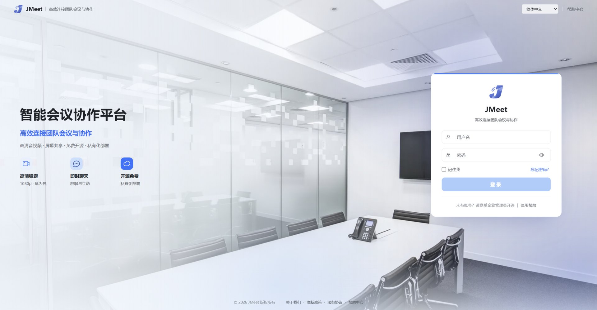
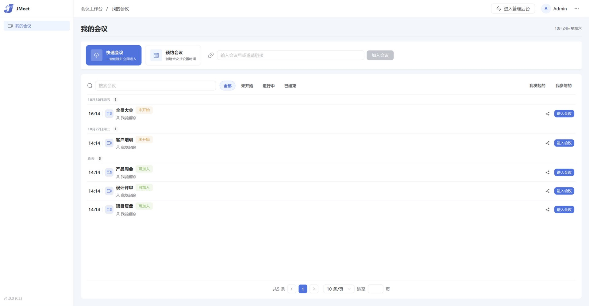
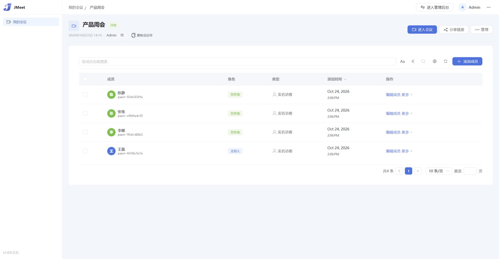
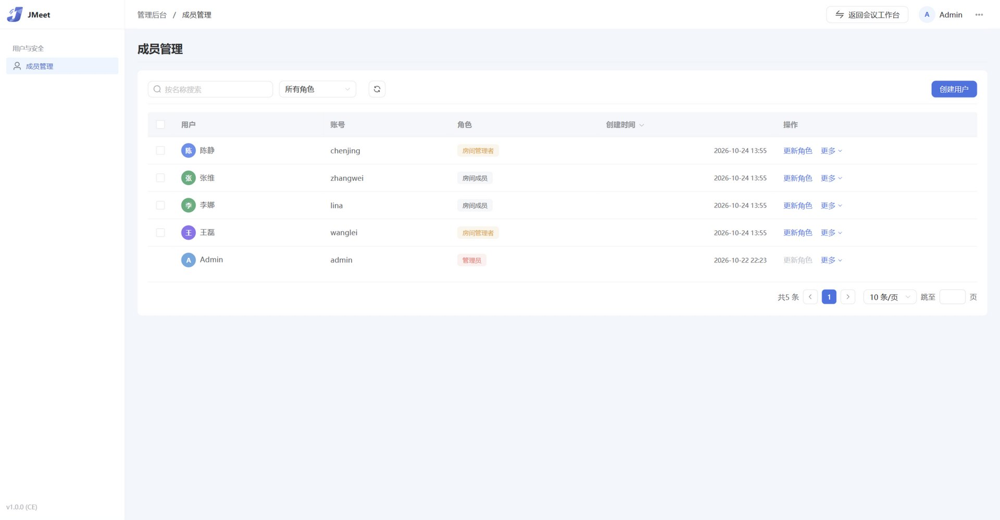

<div align="center">


# JMeet

可私有化部署的开源视频会议系统

[](LICENSE)
[](#快速开始)

基于 LiveKit、Angular 和 Node.js 构建，衍生自 [OpenVidu Meet](https://github.com/OpenVidu/openvidu-meet) 3.8.0。

</div>

## 界面预览

| 登录 | 会议工作台 |
|---|---|
|  |  |

| 房间管理 | 成员管理 |
|---|---|
|  |  |

## 功能

- 音视频会议：屏幕共享、虚拟背景、AI 降噪、端到端加密、宫格与智能平铺布局
- 会议入会：数字会议号、邀请链接、举手发言、会中群聊
- 主持管控：全体静音、锁定会议、移出与会者
- 管理后台：本地账号、用户管理、房间与成员管理
- 部署：单机 Docker Compose，公网与纯内网两种模式

## 默认限制

| 限制项 | 数值 |
|---|---|
| 单场会议人数 | 50 人 |
| 并发会议数 | 3 场 |

限制在源码中可自行调整。

## 快速开始

准备一台 Linux 服务器（建议 4 核 8G 起步）和两个域名：

```bash
git clone <本仓库地址>
cd jmeet/deployment
cp .env.public.example .env.public
vi .env.public
bash deploy.sh public
```

访问 `https://<你的域名>/meet/`，默认管理员账号 `admin`。纯内网部署将 `public` 换成 `intranet`，见 [deployment/README.md](deployment/README.md)。

## 开发

Node.js 22+，pnpm 9+。

```bash
./meet.sh dev                  # 开发模式，默认端口 6081
./meet.sh build                # 全量构建
./meet.sh test-unit-backend    # 后端单元测试
./meet.sh test-unit-frontend   # 前端单元测试
```

开发环境配置在 `meet-ce/backend/.env.dev`，默认管理员 `admin/admin`。

生产模式下服务端缓存 index.html，前端重新构建后需要重启服务。

## 目录结构

```text
jmeet/
├── meet.sh                    # 构建/开发/测试入口脚本
├── deployment/                # Docker Compose 部署
├── docs/                      # 项目文档
└── meet-ce/
    ├── typings/               # 前后端共享类型
    ├── backend/               # Node.js/Express 后端
    ├── docker/                # 生产镜像 Dockerfile
    └── frontend/              # Angular 前端
        └── projects/shared-meet-components/   # 共享组件库
```

## 企业版

企业版提供录制、AI 字幕与会议纪要、白板协作、企微/钉钉/飞书/OIDC/LDAP 身份集成、SIP/H.323 互通、集群与白标等能力，联系维护团队获取详情。

## 许可证

[Apache License 2.0](LICENSE)
